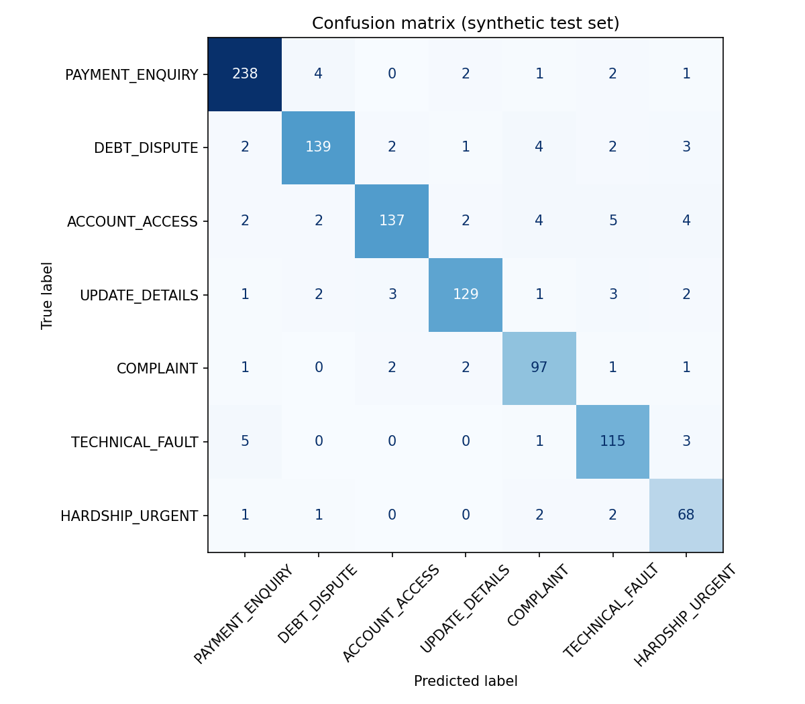
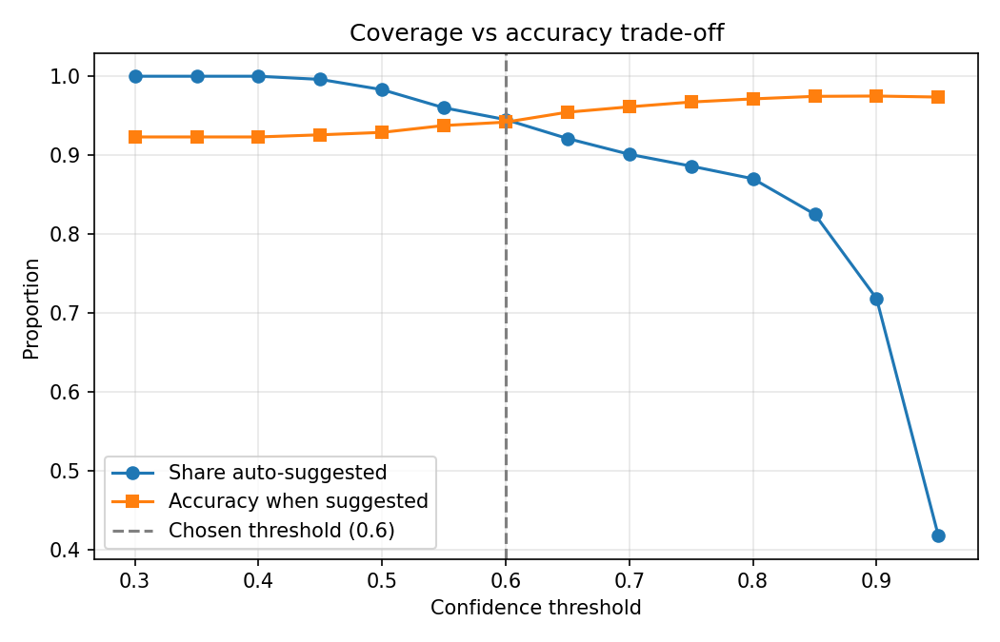

# AI-Assisted Triage of Citizen Service Requests

**A simulated Business Analyst engagement for a federal-government-style client, covering the full project lifecycle from discovery to pilot-readiness, with a working machine-learning prototype.**

> ### Please read: what this is and is not
> - This is a **portfolio project and simulation**. The client, *Department of Citizen Services Delivery (DCSD)*, is **fictional**.
> - **No real citizen data** is used. The dataset is generated by [`src/generate_data.py`](src/generate_data.py).
> - Stakeholder interviews and the requirements workshop are **simulated** from role-based personas. Volumes, hourly costs and project costs are **labelled planning assumptions**.
> - Model results come from **synthetic data** and show feasibility only. Real-world performance would differ, and the documents say so repeatedly.
> - Nothing here is legal advice or an official government assessment.

## The scenario
DCSD staff read and route every inbound service request by hand. This is slow at peak times, inconsistent, and risks urgent hardship cases waiting in routine queues. As the Business Analyst, I explore whether AI-assisted triage could help **without taking decisions away from people**, and what must be true (requirements, governance, privacy, fairness, business value) before a pilot.

## Headline results (synthetic data, seed 42)
| Measure | Result |
|---|---|
| Classifier accuracy (1,000 held-out requests) | **92.3%** (majority-class baseline 24.8%) |
| Macro F1 | **0.915** (5-fold CV 0.912 ± 0.005) |
| Requests given a suggested route | 86.6% |
| Accuracy of those suggested routes | 95.0% |
| Sent to manual queue (low confidence) | 4.5% |
| Escalated to priority (hardship or safety rules or model) | 8.9% |
| Hardship cases escalated | 94.6% (70 of 74); the 4 misses were mislabelled records |
| **Largest accuracy gap between groups** | **8.2 points by writing style, above the 5-point limit I set** |

The last row is deliberate: the fairness check works, it found a problem, and the repository records the issue ([I-03](docs/08_raid_log.md)) and a treatment plan rather than hiding it. See [doc 14](docs/14_ai_governance_assessment.md).




## Design principles
1. **Suggest, never decide.** No eligibility, payment or debt decisions; no contact with citizens.
2. **Safety rules run before the model** and cannot be overridden by it.
3. **Uncertain means human.** Low confidence goes to a manual queue.
4. **Every suggestion is explained** in plain language.
5. **Fairness and performance are measured by group**, continuously.
6. **Staged rollout:** approvals, then shadow mode, then assisted mode, with decision gates.

## Business analysis deliverables
| # | Document | What it shows |
|---|---|---|
| 00 | [Project charter](docs/00_project_charter.md) | Objectives, scope, RACI, glossary |
| 01 | [Stakeholder map](docs/01_stakeholder_map.md) | Register, power/interest grid, engagement plan |
| 02 | [Interview guide and synthesis](docs/02_stakeholder_interview_guide.md) | Elicitation questions, themes (simulated) |
| 03 | [Workshop plan and outcomes](docs/03_workshop_plan_and_outcomes.md) | Agenda, facilitation, MoSCoW, decisions (simulated) |
| 04 | [Business requirements (BRD)](docs/04_business_requirements.md) | 14 business requirements with measures |
| 05 | [Functional and non-functional requirements](docs/05_functional_requirements.md) | 15 FRs, 10 NFRs, decision logic |
| 06 | [User stories and acceptance criteria](docs/06_user_stories_and_acceptance_criteria.md) | 16 stories, Given/When/Then |
| 07 | [Process maps](docs/07_process_maps.md) | As-is and to-be (Mermaid), role changes |
| 08 | [RAID log and decision log](docs/08_raid_log.md) | Risks, assumptions, issues, dependencies, decisions |
| 09 | [Backlog and sprint plan](docs/09_backlog_and_sprint_plan.md) · [`backlog.csv`](docs/backlog.csv) | Agile cadence, two sprints, roadmap |
| 10 | [Status report](docs/10_status_report.md) | RAG status, metrics, decisions needed |
| 11 | [Business case](docs/11_business_case.md) | Options, scenarios, gates, honest sensitivity |
| 12 | [Briefing paper](docs/12_briefing_paper.md) | Executive decision paper |
| 13 | [Impact assessment](docs/13_impact_assessment.md) | AI use case risk, privacy (APPs), security, legal notes |
| 14 | [AI governance assessment](docs/14_ai_governance_assessment.md) | Model card, fairness, ethics principles, DTA policy v2.0 checklist, monitoring |
| 15 | [Guide for non-technical stakeholders](docs/15_model_explainer_for_stakeholders.md) | Plain-language explanation |
| 16 | [Traceability matrix](docs/16_traceability_matrix.md) | Objectives → requirements → stories → tests |

## Prototype
```
src/
  config.py          categories, routing table, threshold, safety and hardship rules
  generate_data.py   synthetic dataset generator (4,000 requests, deliberately messy)
  train_model.py     training, baselines, threshold trade-off, fairness, reports
  triage.py          triage service and command-line tool
tests/test_triage.py acceptance-style tests linked to user stories
data/                synthetic_requests.csv (generated)
reports/             metrics, charts, fairness table, top terms
```

### Run it
Requires Python 3.10+.
```bash
python -m venv .venv && source .venv/bin/activate      # Windows: .venv\Scripts\activate
pip install -r requirements.txt

python -m src.generate_data      # optional: regenerate the synthetic data (seeded, reproducible)
python -m src.train_model        # trains, evaluates, writes reports/ and models/
python -m unittest discover -s tests -v

python -m src.triage "I have no food and my payment has not arrived"
python -m src.triage "I cant log in and the reset email never arrives"
```
Example output:
```
            action: PRIORITY_HUMAN_ESCALATION
          category: HARDSHIP_URGENT
              team: Priority Case Team
 sla_business_days: 1
        confidence: 0.9655722910638429
           reasons: ['food', 'no', 'have no', 'payment has', 'has not']
             flags: ['HARDSHIP_RULE']
```
Exact numbers can vary slightly across scikit-learn versions; the committed `reports/` were produced with scikit-learn 1.8.

## Business analysis skills demonstrated
| Skill | Where to see it |
|---|---|
| Stakeholder analysis and engagement | docs 01, 02 |
| Elicitation: interviews and workshop facilitation | docs 02, 03 |
| Requirements: business, functional, non-functional, traceability | docs 04, 05, 16 |
| User stories and acceptance criteria | doc 06 |
| Process mapping (as-is and to-be) | doc 07 |
| RAID management and decision logging | doc 08 |
| Agile delivery: backlog, sprint planning, ceremonies | doc 09 |
| Project reporting | doc 10 |
| Business case, options analysis, benefits realisation | doc 11 |
| Governance documentation, briefing papers, impact assessments | docs 12, 13, 14 |
| AI/ML delivery: model evaluation, fairness, explainability, monitoring | docs 14, 15; `src/`, `reports/` |
| Python, scikit-learn, pandas, testing | `src/`, `tests/` |

## Limitations
- Synthetic, templated text is much easier than real correspondence; real accuracy would be lower.
- English only; seven categories; multi-topic requests are labelled by their primary topic.
- Group fairness results depend partly on how the generator produces writing styles and use small groups.
- The business case uses assumed volumes and costs. It should be rerun with agency data.
- The production items (audit log, override capture, monitoring, officer interface) are specified but not built (see [traceability matrix](docs/16_traceability_matrix.md)).

## References used
- Australian Government Digital Transformation Agency, *Policy for the responsible use of AI in government* (v2.0, effective 15 December 2025).
- Australia's AI Ethics Principles (Department of Industry, Science and Resources).
- Privacy Act 1988 (Cth) and the Australian Privacy Principles; Protective Security Policy Framework; Information Security Manual.

## Author
Aditya Subbiah Sudar. Master of Business Analytics, Deakin University.

## Licence
MIT. See [LICENSE](LICENSE).
