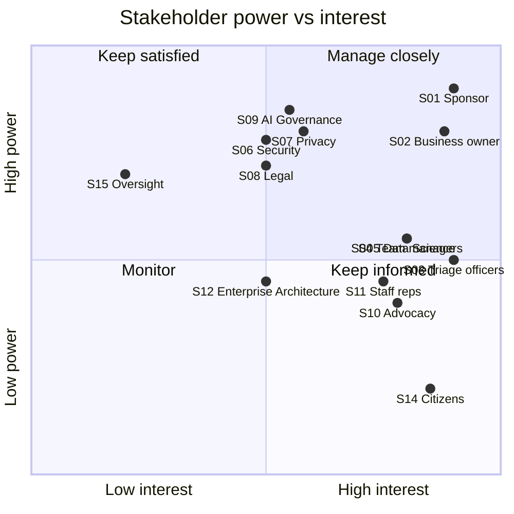

# 01 · Stakeholder Map and Engagement Plan

*Simulated engagement. Roles are fictional DCSD roles; no real individuals are represented.*

## 1. Stakeholder register
| ID | Stakeholder (role) | Interest in the initiative | Influence | Interest | Attitude (assumed) | Engagement approach |
|----|---|---|---|---|---|---|
| S01 | Executive General Manager, Service Delivery (Sponsor) | Faster service, cost, reputational risk | High | High | Supportive, cautious on risk | Fortnightly steering update; decision paper |
| S02 | Director, Contact Centre Operations (Business owner) | Queue times, SLA performance, staff workload | High | High | Supportive | Weekly working session; co-owns requirements |
| S03 | Triage officers and team leaders (primary users) | Job security, usability, trust in suggestions | Medium | High | Mixed: curious but concerned about replacement | Interviews, workshop, user testing, early demos |
| S04 | Receiving team managers (Payments, Debt Review, Records, Account Support, Digital Support, Complaints, Priority Case) | Correct, well-formed referrals; fewer re-routes | Medium | High | Supportive if misrouting falls | Workshop; monthly pilot metrics |
| S05 | Data Science Lead | Technical feasibility, data quality, MLOps | Medium | High | Supportive | Daily collaboration; model review |
| S06 | Chief Information Security Officer / Security Advisor | Data classification, hosting, access control | High | Medium | Cautious | Early security consult; sign-off gate |
| S07 | Privacy Officer | APP compliance, PIA, data minimisation | High | Medium | Cautious | PIA threshold assessment; sign-off gate |
| S08 | Chief Counsel / Legal | Administrative law, automated decision-making, liability | High | Medium | Cautious | Legal review of design principles |
| S09 | AI Accountable Official and AI Governance Committee | Policy compliance (DTA AI policy), use-case register, risk rating | High | Medium | Neutral; wants evidence | Impact assessment submission; committee paper |
| S10 | Customer advocacy and community welfare reps | Equity, access for vulnerable groups, transparency | Medium | High | Sceptical, constructive | Consultation session; review of fairness findings |
| S11 | Staff representatives | Workforce impact, consultation obligations | Medium | High | Sceptical | Early briefing; consult on role redesign |
| S12 | Enterprise Architecture / IT Delivery | Integration, tooling, environments | Medium | Medium | Neutral | Architecture review; dependency tracking |
| S13 | Delivery Lead and project team | Scope, schedule, quality | Medium | High | Supportive | Daily stand-up |
| S14 | Citizens, incl. people in hardship, regional/remote, culturally and linguistically diverse (CALD) customers | Timely, fair response; being understood | Low (direct) | High | Unknown | Represented through S10; service design principles |
| S15 | External oversight (e.g. Commonwealth Ombudsman, Auditor-General) | Accountability, lawful administration | High (indirect) | Low | Neutral | Design for auditability and records |

## 2. Power / interest grid

## 3. Engagement plan
| Quadrant | Stakeholders | Cadence | Channel | Owner |
|---|---|---|---|---|
| Manage closely | S01, S02, S09, S06, S07, S08 | Weekly or fortnightly + gates | Working sessions, decision papers | BA / Delivery Lead |
| Keep informed (high interest) | S03, S04, S05, S10, S11, S14 (via S10) | Fortnightly | Workshops, demos, newsletter | BA |
| Keep satisfied | S15 | At milestones | Briefing, audit-ready records | Delivery Lead |
| Monitor | S12 | As needed | Architecture forum | BA |

## 4. Key stakeholder concerns and responses
| Concern | Raised by | How the project responds |
|---|---|---|
| "Will this replace triage officers?" | S03, S11 | Role is redesigned, not removed: officers review suggestions and handle exceptions. Consultation planned (RAID I-02). |
| "What if it misses someone in crisis?" | S02, S10 | Safety and hardship rules run before the model; hardship never auto-queued as routine; 100% human review in pilot. |
| "Is citizen data safe?" | S06, S07 | Synthetic data for PoC; PIA and security assessment gates before any real data. |
| "Can we explain a decision to a citizen or the Ombudsman?" | S08, S15 | Every suggestion returns plain-language reasons; all outputs logged; humans decide. |
| "Will it treat everyone equally?" | S10 | Fairness testing by group is a standing requirement; first findings in [doc 14](14_ai_governance_assessment.md). |

## 5. Communication risks
Highest risk is S03/S11 resistance if the project is perceived as workforce reduction. Mitigation: involve officers as co-designers, publish measures that include staff experience, and frame benefits as capacity redirected to complex and urgent work.
