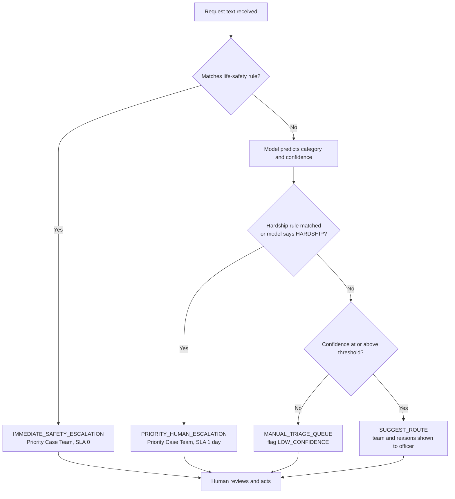

# 05 · Functional and Non-Functional Requirements (FRD)

*Simulated engagement. Status column states honestly what exists in this repository's prototype and what would need a production build.*

Status key: **Implemented** = in `/src` and tested or evidenced · **Design** = specified, not built · **Partial**.

## 1. Functional requirements
| ID | Requirement | BR | Priority | Status | Where |
|----|-------------|----|----------|--------|-------|
| FR-01 | The system shall classify a free-text request into one of seven categories and return a probability for the top category | BR-01 | Must | Implemented | `src/train_model.py`, `src/triage.py` |
| FR-02 | The system shall map each category to a receiving team and service-level target from a routing table | BR-01 | Must | Implemented | `src/config.py` (`ROUTING`) |
| FR-03 | The system shall return a confidence value with every suggestion | BR-06 | Must | Implemented | `TriageResult.confidence` |
| FR-04 | If confidence is below the configured threshold, the system shall place the request in the manual triage queue | BR-03 | Must | Implemented | `TriageService.triage` |
| FR-05 | If the text matches a hardship rule, the system shall escalate to the Priority Case Team regardless of the model output | BR-04 | Must | Implemented | `HARDSHIP_PATTERNS` |
| FR-06 | If the text matches a life-safety rule, the system shall escalate immediately with a zero-day service level, before the model runs | BR-05 | Must | Implemented | `LIFE_SAFETY_PATTERNS` |
| FR-07 | The system shall return up to five influential words or phrases as a plain-language reason | BR-06 | Must | Implemented | `_top_terms` |
| FR-08 | Authorised administrators shall be able to change the threshold and phrase lists under version control and approval | BR-11 | Should | Partial (config file) | `src/config.py` |
| FR-09 | The system shall write an audit record per request: ID, time, model version, rules matched, suggestion, confidence, reasons, officer action | BR-09 | Must | Design | n/a |
| FR-10 | Officers shall be able to accept or override a suggestion and record a reason code | BR-12 | Should | Design | n/a |
| FR-11 | The system shall report performance by writing style, region and channel and highlight gaps above 5 points | BR-10 | Should | Implemented | `reports/fairness_by_group.csv` |
| FR-12 | The system shall produce monthly monitoring metrics: accuracy on a reviewed sample, hardship recall, group gaps, override rate, drift | BR-14 | Should | Design | n/a |
| FR-13 | The officer queue view shall show suggested category, team, confidence, reasons and flags | BR-06, BR-07 | Should | Design | n/a (CLI only) |
| FR-14 | The system shall have no ability to send communications or record decisions; outputs are labelled "suggestion for human review" | BR-07 | Must | Implemented by design | no outbound interface |
| FR-15 | The system shall handle empty, malformed or very long input without error | BR-03 | Must | Implemented (odd input) | `tests/test_triage.py` |

## 2. Decision logic (triage service)

## 3. Non-functional requirements
| ID | Category | Requirement | BR | Status |
|----|----------|-------------|----|--------|
| NFR-01 | Performance | Target: 95% of requests classified in under 2 seconds in the production environment | BR-02 | Target; prototype not benchmarked |
| NFR-02 | Availability | Target: 99.5% during business hours; on outage all requests flow to the manual queue | BR-03 | Design |
| NFR-03 | Security | Hosted in an Australian environment assessed for the data's classification; encryption in transit and at rest; role-based access; aligned with PSPF and ISM | BR-08 | Design |
| NFR-04 | Privacy | Data minimisation; masking of personal information in logs; no use of real data for training until the PIA is approved; retention per records obligations | BR-08 | Design |
| NFR-05 | Explainability | Reasons presented in plain English without technical terms | BR-06 | Implemented (terms); wording is a UX task |
| NFR-06 | Fairness | Accuracy gap between any two groups ≤ 5 percentage points; breach triggers review | BR-10 | Reported; **current writing-style gap is 8.2 points on synthetic data** ([doc 14](14_ai_governance_assessment.md)) |
| NFR-07 | Accessibility | Staff interface meets WCAG 2.1 AA at minimum | BR-06 | Design |
| NFR-08 | Auditability | Training runs reproducible: fixed random seed, versioned data and code, stored metrics | BR-09 | Implemented (seed, reports) |
| NFR-09 | Maintainability | Automated tests; quarterly review of model and phrase lists; versioned releases | BR-14 | Partial (tests exist) |
| NFR-10 | Resilience | Any processing error results in manual-queue routing, never silent failure | BR-03 | Design |

## 4. Data requirements
| Item | Specification |
|---|---|
| Input | Request ID, free-text body, channel (web form, email, phone transcript) |
| Output | Category, team, SLA days, action, confidence, reasons, flags, model version |
| Categories | PAYMENT_ENQUIRY, DEBT_DISPUTE, ACCOUNT_ACCESS, UPDATE_DETAILS, COMPLAINT, TECHNICAL_FAULT, HARDSHIP_URGENT |
| Labels for training | Historical triage outcomes, reviewed and relabelled by senior officers using written labelling guidelines (production); synthetic labels (prototype) |
| Group attributes for fairness testing | Writing style, region, channel (prototype); production would use only attributes lawfully held and approved by the Privacy Officer |
| Retention | Per applicable records schedule; to be confirmed with the agency records manager |

## 5. Interface requirements
| Interface | Direction | Notes |
|---|---|---|
| Request intake (web form, email, transcript) | In | Text only; attachments excluded from scope |
| Case-management queue | Out | Suggestion written to a field; routing performed by officer or by an approved rule after pilot |
| Audit store | Out | Append-only |
| Monitoring dashboard | Out | Monthly report to use case owner and AI Governance Committee |

## 6. Out of scope for this release
Auto-replies, translation, attachment analysis, policy or eligibility decisions, integration with identity systems.
