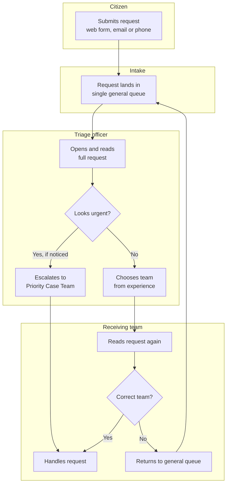
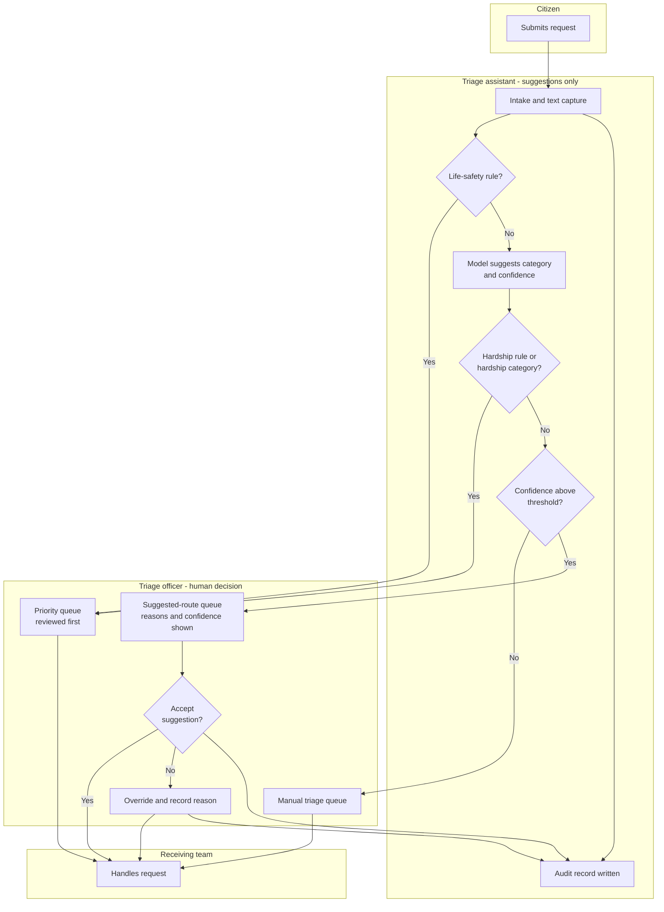

# 07 · Process Maps: As-Is and To-Be

*Simulated engagement. The as-is map is a hypothesis built from simulated interviews (doc 02) and validated in the simulated workshop (doc 03). Diagrams are written in Mermaid and render on GitHub.*

## 1. As-is: manual triage

### As-is pain points
| # | Step | Pain point | Evidence | Impact |
|---|------|------------|----------|--------|
| P1 | B | Single queue with no prioritisation; peak-day backlog | Theme T1 | Delayed response for everyone |
| P2 | C | Every request read in full by hand | T1 | About 2.5 min each (assumed), 25,000 hours/year |
| P3 | D | Urgency judged by skimming; cues buried in long text | T3 | Risk that urgent cases wait |
| P4 | E | Routing depends on individual experience | T2 | Inconsistent decisions |
| P5 | G–J | Misrouted requests are read twice and bounce back | T2 | Assumed 10–15% re-routed; rework |
| P6 | all | No structured data on request reasons | Workshop rank 5 | No insight for service improvement |

## 2. To-be: AI-assisted triage with human in the loop

### To-be improvements
| As-is pain point | To-be change | Requirement |
|---|---|---|
| P1 single queue | Separate priority, manual and suggested queues | BR-04, BR-05 |
| P2 read in full by hand | Officer reviews a suggestion and reasons; reads in full only when needed | BR-01, BR-02 |
| P3 urgency by skimming | Safety and hardship rules plus model flag run on every request | BR-04, BR-05 |
| P4 inconsistent routing | Same logic applied every time; overrides captured | BR-01, BR-12 |
| P5 re-routing | Higher first-time accuracy and low-confidence handling | BR-03 |
| P6 no data | Structured category and reason data for every request | BR-09, BR-14 |

## 3. Role changes (for staff consultation)
| Role | Today | To-be |
|---|---|---|
| Triage officer | Reads and routes every request | Reviews suggestions, handles priority and low-confidence cases, validates and corrects the system |
| Team leader | Manages queue backlog | Monitors queue mix, override trends and quality sampling |
| Priority Case Team | Receives cases that officers happen to notice | Receives systematically flagged cases, owns the phrase list |
| Data Science Lead | n/a | Owns model monitoring and retraining under change control |

Consultation with staff and their representatives is required before any role change (RAID I-02, C-02).

## 4. Pilot rollout path
Shadow mode (suggestions recorded but not shown) → assisted mode for low-risk categories with 100% human review → expanded categories → review at 12 months. Detailed gates in [doc 11](11_business_case.md) and [doc 12](12_briefing_paper.md).
