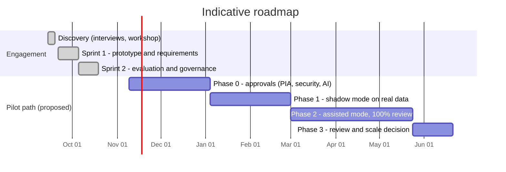

# 09 · Backlog, Sprint Plan and Delivery Cadence

*Simulated engagement run as two two-week sprints after a one-week discovery. The full backlog is in [`backlog.csv`](backlog.csv) (import-ready for Jira or Trello); stories and acceptance criteria are in [doc 06](06_user_stories_and_acceptance_criteria.md).*

## 1. Delivery approach
| Item | Approach |
|---|---|
| Method | Scrum-style iterative delivery with a BA acting as product owner proxy for the business owner |
| Sprint length | 2 weeks |
| Assumed capacity | 30 points per sprint (team of BA, data science lead, part-time delivery lead) |
| Estimation | Fibonacci story points, relative to US-02 (2 points) |
| Prioritisation | MoSCoW from workshop, adjusted for dependencies and risk |
| Tools | Jira or Trello board with columns Backlog, Ready, In progress, In review, Done |

## 2. Ceremonies
| Ceremony | When | Duration | Purpose | Attendees |
|---|---|---|---|---|
| Backlog refinement | Weekly | 45 min | Clarify stories, acceptance criteria, estimates | BA, Data Science Lead, business owner |
| Sprint planning | Day 1 | 1 hour | Commit to sprint goal and backlog | Whole team |
| Daily stand-up | Daily | 15 min | Progress, blockers | Team |
| Sprint review | Last day | 45 min | Demonstrate working increment; collect feedback | Team, business owner, invited stakeholders |
| Retrospective | Last day | 30 min | Improve ways of working | Team |
| Steering update | Fortnightly | 30 min | Decisions, risks, funding | Sponsor, business owner, Delivery Lead |

## 3. Roadmap

## 4. Sprint 1: "A safe, explainable routing suggestion"
**Goal:** Deliver a working suggestion service with safety rules, low-confidence handling and explanations, and agree requirements.

| ID | Title | Persona | Pri | Pts | Status |
|---|---|---|---|---|---|
| US-01 | The system to suggest which team should handle each incoming request | triage officer | Must | 5 | Done (prototype) |
| US-02 | To see how confident the system is in each suggestion | triage officer | Must | 2 | Done (prototype) |
| US-03 | Uncertain requests to go to a manual triage queue instead of being guessed | team leader | Must | 3 | Done (prototype) |
| US-04 | Requests that mention financial hardship to be escalated to my team regardless of the model's category | Priority Case Team manager | Must | 5 | Done (prototype) |
| US-05 | Requests that indicate risk to personal safety to be escalated immediately | Priority Case Team manager | Must | 3 | Done (prototype) |
| US-06 | A plain-language reason for each suggestion | triage officer | Must | 3 | Done (prototype) |
| US-14 | Certainty that the tool cannot take decisions or contact citizens | Chief Counsel | Must | 2 | Done by design |
| EN-01 | Baseline process maps and requirements pack | Business Analyst | Must | 5 | Done |
| EN-02 | Set up RAID log and decision log | Business Analyst | Must | 2 | Done |

Enabler tasks: EN-01 Baseline process maps and requirements pack (5), EN-02 RAID and decision log (2).
**Sprint 1 total: 30 points.**

## 5. Sprint 2: "Evidence and assurance"
**Goal:** Evaluate performance and fairness, build the business case and complete governance assessments.

| ID | Title | Persona | Pri | Pts | Status |
|---|---|---|---|---|---|
| US-07 | An evaluation report showing how well the classifier performs and how it compares with simple baselines | Director, Contact Centre Operations | Must | 5 | Done (prototype) |
| US-08 | Performance reported separately for different writing styles, regions and channels | AI Governance Committee member | Should | 5 | Done (prototype) |
| US-11 | To adjust the confidence threshold and review the phrase lists without a code release | Director, Contact Centre Operations | Should | 3 | Partial (config file only) |
| EN-03 | Options analysis and business case | Business Analyst | Must | 5 | Done |
| EN-04 | AI impact assessment and governance assessment | Business Analyst | Must | 8 | Done |
| EN-05 | Privacy and security threshold analysis | Business Analyst | Must | 2 | Done |
| EN-06 | Briefing paper and status report | Business Analyst | Should | 2 | Done |

Enabler tasks: EN-03 Options analysis and business case (5), EN-04 AI impact and governance assessment (8), EN-05 Privacy and security threshold analysis (2), EN-06 Briefing paper and status report (2).
**Sprint 2 total: 30 points.**

## 6. Pilot backlog (not started)
These stories need a production build and approvals (RAID D-01, D-02, D-04).

| ID | Title | Persona | Pri | Pts | Status |
|---|---|---|---|---|---|
| US-09 | To accept or override a suggestion and record a reason | triage officer | Should | 5 | Backlog (needs production build) |
| US-10 | A complete audit record for each triaged request | Legal and oversight reviewer | Must | 5 | Backlog (needs production build) |
| US-12 | Monthly monitoring of accuracy, group gaps, override rate and data drift | Data Science Lead | Should | 5 | Backlog (needs production build) |
| US-13 | The system to fail safe by sending requests to the manual queue if anything goes wrong | triage officer | Must | 3 | Backlog (needs production build) |
| US-15 | Referred requests to arrive with the category and the reason for routing | receiving team manager | Could | 2 | Backlog (needs production build) |
| US-16 | Personal information minimised and masked in logs and training data | Privacy Officer | Must | 5 | Backlog (needs production build) |

## 7. Sprint review and retrospective notes (simulated)
| Sprint | What went well | What to improve | Action |
|---|---|---|---|
| 1 | Safety rules and explanations resonated with officers in the demo | Acceptance criteria for US-04 initially vague on mixed-topic requests | Added the mixed-request criterion and a test |
| 2 | Fairness analysis surfaced a real gap early | Business case relied on assumptions because baseline data had not arrived | Escalated I-01; added sensitivity analysis |
