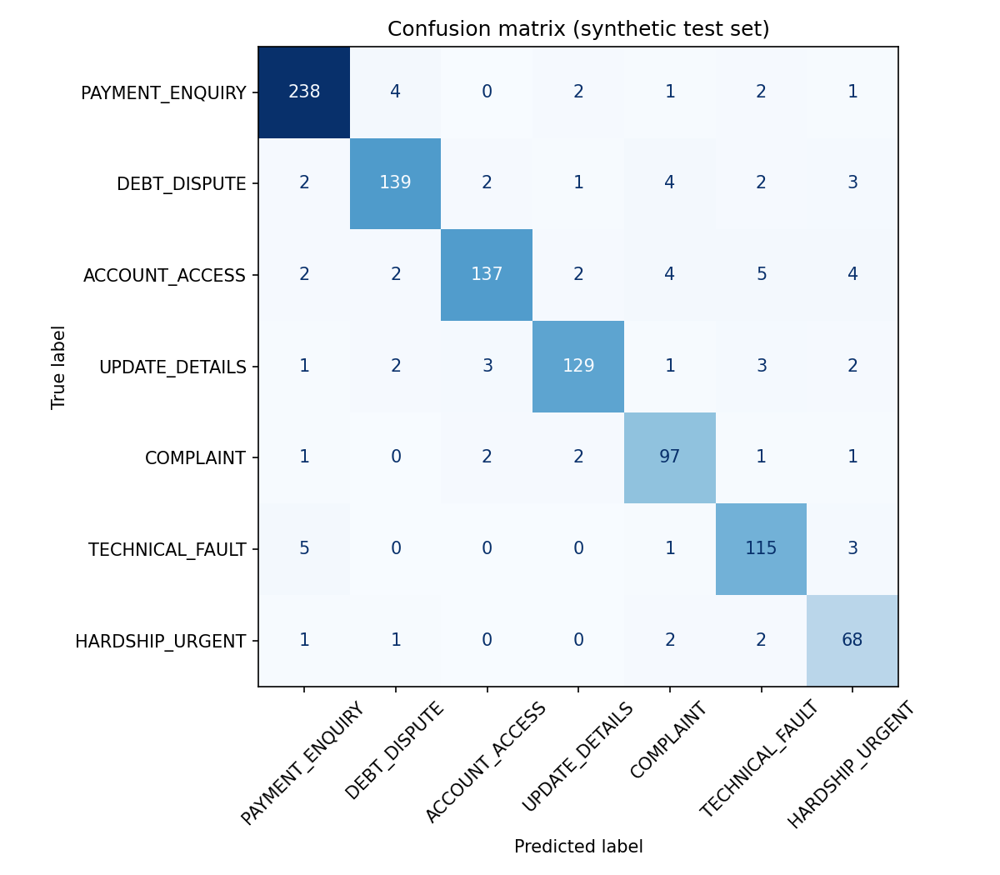
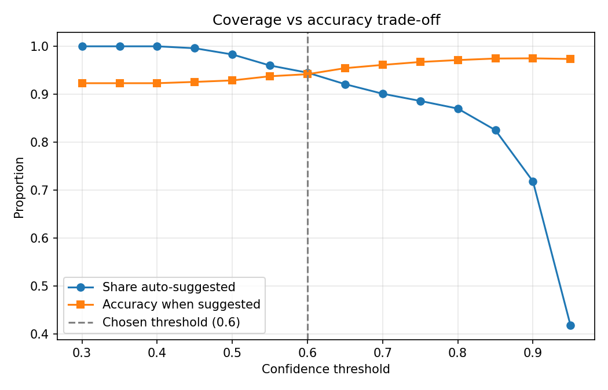

# 14 · AI Governance Assessment, Model Card and Monitoring Plan

*Simulated engagement. Results come from this repository's synthetic dataset (seed 42) and are reproducible with `python -m src.train_model`. Obligations are summarised from the DTA's published Policy for the responsible use of AI in government v2.0 (effective 15 December 2025); the agency must confirm requirements against the current policy.*

## 1. What the evidence does and does not show
| It shows | It does not show |
|---|---|
| The approach is technically feasible and a simple model matches a second baseline | Real-world accuracy: synthetic text is templated and far less varied than real requests |
| Safety rules, thresholds and explanations can be implemented and tested | That hardship recall will reach 99% on real language |
| A fairness test can detect group gaps and has detected one | That the gaps found are real: they are partly an artefact of how writing styles were generated |
| Label noise affects measured results (I-04) | The true label quality of historical data |

## 2. Model card
| Item | Detail |
|---|---|
| Model | TF-IDF (word 1–2 grams, min document frequency 2) → multinomial logistic regression (C = 4, balanced class weights) |
| Intended use | Suggest receiving team for English free-text service requests, with human review |
| Out-of-scope use | Decisions about eligibility, payments, debts; automated replies; other languages; use without human review |
| Training data | 3,000 synthetic requests (75% of 4,000); 7 categories; 2% label noise and 12% multi-intent messages injected deliberately |
| Evaluation data | 1,000 held-out synthetic requests (stratified) |
| Test accuracy | 92.3% (majority-class baseline 24.8%) |
| Macro F1 | 0.915 (5-fold cross-validation mean 0.912, standard deviation 0.005) |
| Comparison | Naive Bayes reached the same accuracy (92.3%, macro F1 0.9155) |
| Per-category F1 | Payment enquiry 0.956 · Debt dispute 0.924 · Account access 0.913 · Update details 0.931 · Complaint 0.907 · Technical fault 0.906 · Hardship 0.872 |
| Explainability | Top contributing terms per request; global term weights in `reports/top_terms_by_category.csv` |
| Known limitations | English only; synthetic and templated; short or vague messages go to manual queue; multi-intent messages are labelled by primary topic only; hardship category has the lowest F1 |
| Ethical considerations | Possible unequal performance by writing style; over-reliance by staff; sensitive content in real data |
| Version / date | v1.0 · October 2026 |

## 3. End-to-end system results (rules + model + threshold)
| Measure | Result |
|---|---|
| Suggested route given | 86.6% of requests |
| Accuracy of suggested routes | 95.0% |
| Sent to manual queue (low confidence) | 4.5% |
| Escalated as priority (rules or model) | 8.9% |
| False escalation of non-hardship requests | 2.1% |
| Hardship cases escalated | 70 of 74 (94.6%); the 4 not escalated all had recorded labels that contradicted their text (see I-04) |

The threshold of 0.60 was chosen from the trade-off analysis (`reports/threshold_tradeoff.csv`). Model-only at 0.60: 94.5% of requests clear the threshold with 94.2% accuracy; at 0.80, 87.0% clear with 97.1% accuracy. A higher threshold buys accuracy at the price of more manual work.

## 4. Fairness findings
| Attribute | Group | n | Accuracy | Gap to best group |
|---|---|---|---|---|
| Writing style | Terse | 150 | 97.3% | 0.0 |
| | Plain | 625 | 92.2% | 5.2 |
| | ESL-style | 87 | 89.7% | 7.7 |
| | Formal | 138 | 89.1% | **8.2** |
| Region | Regional | 302 | 93.1% | 0.0 |
| | Metro | 598 | 92.3% | 0.7 |
| | Remote | 100 | 90.0% | 3.1 |
| Channel | Web form | 476 | 93.1% | 0.0 |
| | Email | 315 | 92.1% | 1.0 |
| | Phone transcript | 209 | 90.9% | 2.2 |

**Interpretation.** The writing-style gap (8.2 points) exceeds the 5-point threshold (DEC-05). Sampling uncertainty is material: for a group of about 90 requests the 95% margin of error is roughly ±6 points, so the ESL-style result alone is not conclusive. The ranking reflects how the generator creates each style (formal text adds boilerplate that dilutes the signal; terse text is short and keyword-heavy), so it should not be read as a real-world finding. The finding that matters is that the control works: the test ran automatically, detected a breach and triggered a recorded issue (I-03).

**Treatment plan:** (1) repeat on real data with adequate group sizes and confidence intervals; (2) review text normalisation (for example removing boilerplate openers); (3) add training examples for under-performing styles; (4) consider a per-group confidence threshold so more requests from lower-accuracy groups go to humans; (5) report results to the AI Governance Committee and advocacy representatives. No pilot until the gap is within threshold on real data.

## 5. Alignment with Australia's AI Ethics Principles
| Principle | How the design responds | Evidence / gap |
|---|---|---|
| Human, societal and environmental wellbeing | Prioritises people in hardship; reduces wait for urgent cases | Hardship pathway designed; real-data recall unproven |
| Human-centred values | Humans decide; staff can override | DEC-01; override capture is design-only (US-09) |
| Fairness | Group testing and 5-point rule | Gap found (I-03); treatment planned |
| Privacy protection and security | Synthetic data; PIA and security gates; masking | Design only until approvals (D-01, D-02) |
| Reliability and safety | Rules before model; threshold; fail-safe; tests | 8 automated tests pass; fail-safe in production is design only |
| Transparency and explainability | Reasons per suggestion; public transparency statement; published metrics | Reasons implemented; statement to be drafted |
| Contestability | People can ask for review; human decision maker; audit trail | Complaint path to be documented; audit log design only |
| Accountability | Named use case owner; governance committee; RAID and decision log | Owner not yet named (D-04) |

## 6. DTA AI policy (v2.0) obligations checklist
| Obligation (summarised) | Status for this use case |
|---|---|
| Public AI transparency statement kept current by the agency | Agency-level; add this use case to the statement |
| Accountable official for the policy | Agency-level; engaged as S09 |
| Accountable use case owner for each in-scope use case | **Open (D-04)** |
| Internal register of AI use cases, shared with the DTA on the policy's schedule | Register entry to be drafted from this document |
| AI use case assessment to determine indicative risk; impact assessment for higher-risk cases before deployment | Draft in [doc 13](13_impact_assessment.md); agency to complete its official tool |
| Mandatory staff training on responsible AI use | Pilot training plan to include responsible-AI module |
| Governance, safety reporting and incident management | Section 8 below |
| Report and review high-risk use cases | Not currently rated high-risk; re-assess on trigger events |

## 7. Human oversight design
| Control | Design |
|---|---|
| Human decision | Officer accepts or overrides every suggestion in the pilot |
| Override | One click with reason code; override data reviewed by use case owner |
| Priority queue | Reviewed first each day; service level one business day, zero for life-safety |
| Rule ownership | Hardship and safety phrase lists owned by welfare specialists; reviewed quarterly |
| Blind audits | Weekly sample of accepted suggestions checked by a senior officer without seeing the suggestion |
| Stop button | Use case owner can switch the system to "all manual" immediately |

## 8. Monitoring plan
| Metric | Frequency | Threshold for action | Action |
|---|---|---|---|
| Accuracy of suggestions on reviewed sample | Monthly | Drop of more than 3 points from baseline, or below 95% | Investigate; consider raising threshold; retrain under change control |
| Hardship and safety recall on reviewed sample | Monthly | Below 99% | Immediate review of phrase list and model; incident process |
| Group accuracy gap | Monthly | Above 5 points | Escalate to AI Governance Committee; treatment plan |
| Override rate (team level) | Monthly | Sudden change of more than 5 points, or very low (possible automation bias) | Investigate; targeted training |
| Share to manual queue | Weekly | Outside 2%–15% | Review threshold and input mix |
| Input drift (new vocabulary, new topics) | Monthly | Significant change flagged by monitoring | Review categories and training data |

## 9. Incident management
1. **Detect:** staff report, monitoring alert or complaint.
2. **Contain:** use case owner can switch to manual-only.
3. **Assess:** severity (any missed urgent case is severe).
4. **Notify:** Accountable Official, Privacy Officer if personal information is involved, and affected people as required.
5. **Remediate and learn:** fix, retest, record in the use case register, report to the committee.

## 10. Change control and exit
- Any change to model, threshold, rules or categories needs recorded testing, approval and a version number.
- **Exit criteria:** repeated failure of Gate criteria; severe incident not remediated; loss of required approvals; policy change. Exit plan: revert to manual triage (the process remains documented and staff skills maintained through blind audits and rotation).

## 11. Sample public-facing statement (draft)
"DCSD uses a computer tool to help suggest which team should handle your request and to flag requests that may be urgent. The tool does not make decisions about your payments or services. A DCSD officer reviews every suggestion. If you think your request has been handled incorrectly, you can ask for it to be reviewed."
