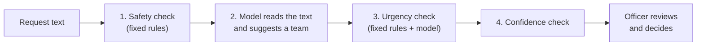

# 15 · How the Triage Assistant Works: A Guide for Non-Technical Stakeholders

*Written for triage officers, managers, governance members and advocates. No technical background needed. Results shown are from synthetic (made-up) data and show feasibility only.*

## 1. In one paragraph
The assistant reads the text of a request and suggests which of seven teams should handle it. It also looks for words and phrases that suggest hardship or safety concerns and sends those to a human straight away. If it is unsure, it says so and the request goes to a person. **It never decides anything about a person's payment, debt or entitlement. A DCSD officer always makes the call.**

## 2. What happens to a request

1. **Safety check.** A fixed list of phrases (for example about being unsafe) triggers immediate escalation. The model cannot override this list.
2. **The model reads the text.** It was shown thousands of past examples and learned which words tend to go with which team (for example "reset" and "log in" go with account access).
3. **Urgency check.** Phrases such as "no food" or "eviction" send the request to the Priority Case Team, even if the model thought it was something else.
4. **Confidence check.** If the model is not confident enough (threshold 0.60 in the prototype), the request goes to the manual queue instead of getting a guess.

## 3. How to read an output
Real outputs from the prototype (`python -m src.triage "<text>"`):

| Request | Action | Team | Confidence | Why (top words) |
|---|---|---|---|---|
| "I cant log in and the reset email never arrives" | Suggest route | Account Support Team | 0.86 | reset, log in, reset email |
| "The debt notice for $412 is wrong, I want to dispute it" | Suggest route | Debt Review Team | 0.98 | debt, debt notice, notice |
| "I have no food and my payment has not arrived" | Priority human escalation | Priority Case Team | 0.97 | food, no, have no (hardship rule matched) |
| "hello" | Manual triage queue | (none) | 0.22 | too little information |
| "I am not safe at home" | Immediate safety escalation | Priority Case Team | n/a | life-safety rule matched |

**Confidence** is how sure the model is, not a guarantee it is right. Treat anything near the threshold with extra care.
**The words shown** are the words that pushed the model towards its suggestion. If they look irrelevant to you, trust your own reading and override.

## 4. What the results mean: "imagine 1,000 requests"
From the synthetic test set:

| Outcome | About how many of 1,000 | What it means |
|---|---|---|
| Suggested route | 866 | Officer reviews a suggestion instead of reading from scratch |
| ...of which correct | 823 | |
| ...of which wrong | 43 | Officer should catch these in review; this is why review is mandatory |
| Manual triage queue | 45 | Model unsure; officer triages as today |
| Priority escalation | 89 | Hardship or safety signals; reviewed first |

On real requests, expect more variety, so more would be unsure and accuracy would likely be lower. That is why the first step is shadow mode.

## 5. What the assistant cannot do
- It cannot decide or communicate with citizens.
- It cannot understand context the way an officer can (sarcasm, a long case history, two problems in one message).
- It works in English only.
- It may work less well for some ways of writing. We test for this by group and report the results (see [doc 14](14_ai_governance_assessment.md)); the current prototype shows a gap that must be treated before any pilot.
- It does not learn on its own. Changes are made by people, tested and approved.

## 6. Questions people ask
**Will this take my job?** The design moves officers from reading everything to reviewing suggestions and handling urgent and unusual cases. Any change to roles requires consultation with staff and their representatives first (RAID C-02, I-02). The business case counts released time as capacity to redirect, not headcount reduction.

**What if it gets it wrong?** Every suggestion is reviewed by an officer. Wrong suggestions are corrected and recorded. A monthly check measures how often it is wrong and for whom.

**What if someone in crisis uses unusual words?** This is the most important risk (R-01). Phrase lists are owned by welfare specialists, officers still read priority-queue items first, and recall on urgent cases is measured every month. If it falls below 99%, the use case owner can switch the assistant off.

**Can it be unfair?** Yes, if it understands some writing styles worse than others. That is why accuracy is reported by group and a gap above 5 points triggers review.

**Does it use my personal information?** The prototype uses made-up data only. Before any real data is used, privacy and security assessments must be completed, and personal details will be masked in logs.

## 7. The reports that go with this guide
| File | What it shows |
|---|---|
| `reports/classification_report.txt` | Accuracy by category |
| `reports/confusion_matrix.png` | Which categories get confused with which |
| `reports/threshold_tradeoff.csv/.png` | How many go to people vs. accuracy at each threshold |
| `reports/fairness_by_group.csv` | Accuracy by writing style, region, channel |
| `reports/top_terms_by_category.csv` | The words the model links to each team |
| `reports/baseline_comparison.csv` | Model vs. simple alternatives |
